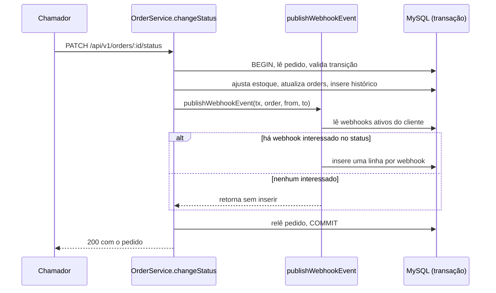
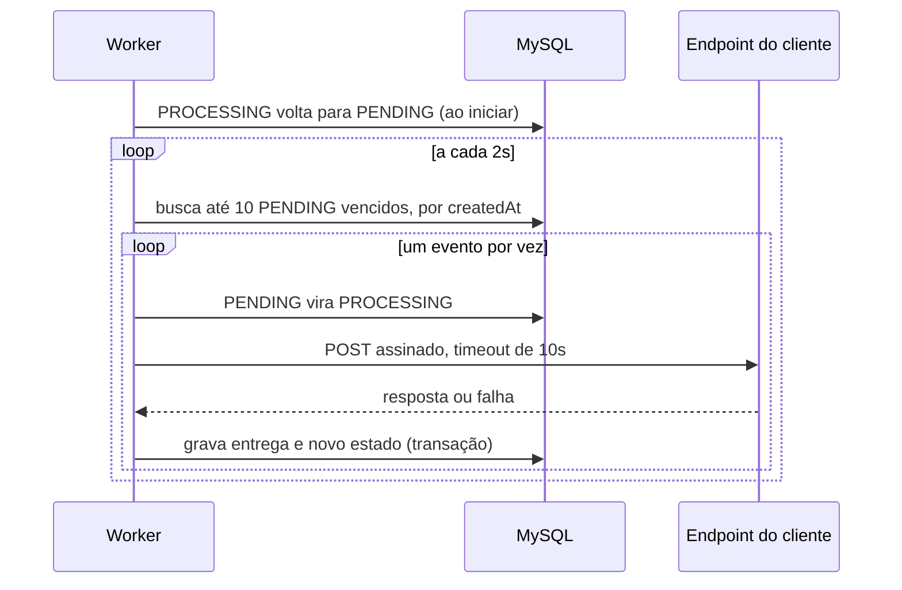
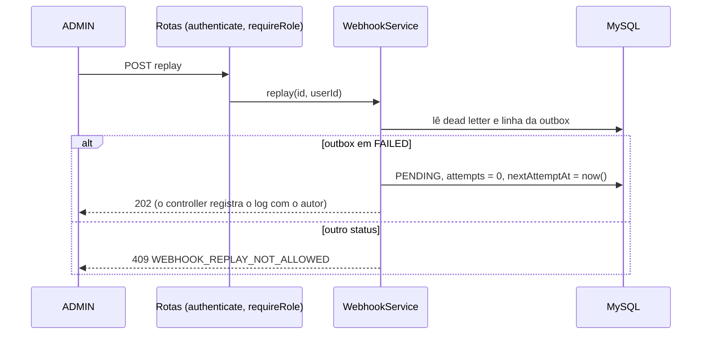

# FDD: Sistema de Webhooks de Notificação de Pedidos

> **Como ler:** as decisões estão nos [ADRs](./adrs/) e a proposta, no [RFC](./RFC.md). Este documento detalha a construção. Tudo marcado com ⚠️ **INF-NN** não foi decidido na reunião: o texto completo de cada inferência e as lacunas que ainda impedem partes da implementação estão no fim do documento.

## 1. Contexto e motivação técnica

Clientes B2B consultam `GET /orders` periodicamente para saber se um pedido mudou (`[09:00] Marcos`). O código não tem eventos, filas, cliente HTTP nem uso de `crypto`, então a feature cria esse caminho de saída do zero.

O ponto crítico é `OrderService.changeStatus` (`src/modules/orders/order.service.ts`), que roda em `prisma.$transaction` e altera estoque, `orders` e `order_status_history`. O desenho precisa acrescentar o evento a essa transação sem colocar nela nenhuma chamada de rede ([ADR-001](./adrs/ADR-001-outbox-no-mysql.md)).

## 2. Objetivos técnicos

| ID | Objetivo | Valor | Fonte |
|---|---|---|---|
| FDD-OBJ-01 | Notificar o cliente em condições normais (⚠️ INF-43) | Menos de 10s | `[09:02] Marcos` |
| FDD-OBJ-02 | Intervalo de polling do worker | 2s | `[09:10] Larissa` |
| FDD-OBJ-03 | Timeout de cada chamada HTTP | 10s | `[09:42] Diego` |
| FDD-OBJ-04 | Teto antes da DLQ | 5 tentativas, em 1m/5m/30m/2h/12h (⚠️ INF-01: 1 envio + 5 reenvios) | `[09:17] Larissa` |
| FDD-OBJ-05 | Limite do payload | 64KB (⚠️ INF-45: 65.536 bytes), sem truncar | `[09:24] Larissa` |
| FDD-OBJ-06 | Carência da secret anterior | 24h | `[09:22] Sofia` |
| FDD-OBJ-07 | Status alterado sem evento registrado | Nenhum caso | `[09:40] Bruno` |

## 3. Escopo e exclusões

**Incluído:** outbox e publicação em `changeStatus`, worker, entrega assinada, retry, DLQ, replay, CRUD de webhooks, rotação de secret e histórico de entregas.

**Excluído:**

| Item | Situação | Referência |
|---|---|---|
| Webhooks de entrada e dashboard | Fora de escopo | RFC-FORA-01, RFC-FORA-02 |
| E-mail, múltiplos workers, rate limiting e arquivamento | Adiados ou em observação | RFC-Q-01, RFC-Q-03, RFC-Q-04, RFC-Q-05 |
| Evento na criação do pedido | Não gera evento | ⚠️ INF-10 |
| Jitter no backoff | Não citado na reunião, portanto não incluído | `[09:17] Diego` |
| Correção do registro público e vínculo `User`–`Customer` | Encaminhada à revisão de segurança (⚠️ INF-38), sem mudança proposta | RFC-RISCO-02, RFC-RISCO-03 |

## 4. Fluxos detalhados

### 4.1 FDD-FLUXO-01: criação do evento na outbox



1. `changeStatus` chama a função logo depois de `tx.orderStatusHistory.create` e antes da releitura do pedido (`[09:40] Bruno`, `[09:41] Bruno`).
2. A função busca os webhooks do cliente com `active = true` (⚠️ INF-31) e filtra pelo `toStatus` (`[09:34] Bruno`).
3. Sem interessados, retorna sem inserir (`[09:34] Bruno`).
4. Para cada interessado, gera um UUID e o usa como `id` da linha e `event_id` do payload (⚠️ INF-04, ⚠️ INF-25).
5. Grava o payload pronto (`[09:52] Larissa`), com `status = PENDING`, `attempts = 0` e `nextAttemptAt = now()` (⚠️ INF-14).
6. Qualquer erro sobe sem tratamento e causa rollback da mudança de status (`[09:40] Bruno`).

A função não faz log nem chamada externa: é "função pura recebendo o tx" (`[09:41] Diego`). O limite de 64KB não é checado aqui (⚠️ INF-02).

```ts
// src/modules/orders/order.service.ts, dentro de changeStatus
await publishWebhookEvent(tx, order, from, to);
```

### 4.2 FDD-FLUXO-02: processamento pelo worker



1. **Início:** `src/worker.ts` devolve a `PENDING` as linhas em `PROCESSING`, que só podem ser sobras de uma queda (⚠️ INF-16).
2. **Leitura:** busca linhas `PENDING` com `nextAttemptAt <= now()`, ordenadas por `createdAt`, limitadas a 10 (`[09:09] Diego`, ⚠️ INF-14, ⚠️ INF-18).
3. **Claim:** uma linha por vez, faz `updateMany` condicional de `PENDING` para `PROCESSING` e pula a linha se a contagem for 0. Não há lock pessimista, porque há um único worker (`[09:12] Diego`, `[09:13] Diego`, ⚠️ INF-33).
4. **Webhook:** carrega a configuração. O caso de webhook removido, inativo ou com URL alterada está em FDD-LAC-02.
5. **Tamanho:** se o corpo serializado passar de 64KB, não envia e vai direto para a DLQ com `WEBHOOK_PAYLOAD_TOO_LARGE` (⚠️ INF-02).
6. **Envio:** serializa o payload uma vez, assina exatamente essa string e a envia no `POST` definido em FDD-CONTRATO-08, com timeout de 10s (`[09:42] Diego`, ⚠️ INF-21, ⚠️ INF-26).
7. **Resultado:** em uma única transação, grava a linha de `webhook_deliveries` (⚠️ INF-15) e atualiza a outbox. Resposta 2xx vira `DELIVERED` (⚠️ INF-13); qualquer outro resultado segue FDD-FLUXO-03.
8. **Próximo ciclo:** espera 2s depois de terminar o ciclo, sem sobrepor ciclos (⚠️ INF-33).

### 4.3 FDD-FLUXO-03: retry

Valores de `[09:17] Diego` e `[09:17] Larissa`. A contagem de chamadas é ⚠️ INF-01.

| Chamada | Tipo | Espera depois da falha anterior | Acumulado desde a primeira falha |
|---|---|---|---|
| 1 | Envio inicial | — | — |
| 2 | Reenvio 1 | 1m | 1m |
| 3 | Reenvio 2 | 5m | 6m |
| 4 | Reenvio 3 | 30m | 36m |
| 5 | Reenvio 4 | 2h | 2h36 |
| 6 | Reenvio 5 | 12h | 14h36 |

Em cada falha, `attempts` aumenta em 1. Se ainda houver reenvio, a linha volta a `PENDING` com `nextAttemptAt = now() + intervalo` (⚠️ INF-06, ⚠️ INF-14). Conta como falha: status fora de 2xx, erro de rede ou timeout (`[09:42] Diego`, ⚠️ INF-13).

Enquanto um evento aguarda o reenvio, o seguinte do mesmo pedido pode ser enviado antes dele (⚠️ INF-05).

### 4.4 FDD-FLUXO-04: DLQ e replay

**Entrada na DLQ**, em uma transação, ao esgotar os reenvios (`[09:15] Diego`) ou ao exceder 64KB (⚠️ INF-02):

1. Insere em `webhook_dead_letter` o payload, o motivo e o timestamp (`[09:18] Diego`). O motivo é o `error` da última tentativa ou `WEBHOOK_PAYLOAD_TOO_LARGE` (⚠️ INF-30).
2. Marca a linha da outbox como `FAILED` (⚠️ INF-06).

**Replay** por `POST /api/v1/admin/webhooks/dead-letter/:id/replay` (`[09:18] Diego`):



1. A rota exige `ADMIN` (`[09:36] Larissa`).
2. A transição usa `updateMany` condicional em `FAILED`, e contagem 0 vira 409, para evitar envios paralelos em um clique duplo (⚠️ INF-29).
3. A linha volta a `PENDING`, mantém o `event_id` e reinicia as tentativas (`[09:18] Diego`, ⚠️ INF-12).
4. O controller, que tem `req.user` e `req.id`, grava o log `webhook_replay_requested` com o autor (`[09:36] Sofia`).

Um evento acima de 64KB volta à DLQ no replay seguinte, porque o snapshot não muda. O destino da linha de `webhook_dead_letter` depois do replay segue em aberto (RFC-Q-08).

## 5. Modelo de dados

Novos modelos em `prisma/schema.prisma`, seguindo a convenção do arquivo: `id` UUID em `Char(36)` (`[09:51] Larissa`), `@@map` em snake_case e colunas em camelCase. Por isso, o `created_at` citado em `[09:08] Diego` fica como `createdAt`. Nomes novos: ⚠️ INF-24.

```prisma
enum WebhookOutboxStatus {
  PENDING
  PROCESSING
  FAILED
  DELIVERED
}

model WebhookEndpoint {
  id                      String    @id @default(uuid()) @db.Char(36)
  customerId              String    @db.Char(36)
  url                     String    @db.VarChar(2048)
  secret                  String    @db.VarChar(64)
  previousSecret          String?   @db.VarChar(64)
  previousSecretExpiresAt DateTime?
  statuses                Json
  active                  Boolean   @default(true)
  createdAt               DateTime  @default(now())
  updatedAt               DateTime  @updatedAt

  customer Customer @relation(fields: [customerId], references: [id])

  @@index([customerId])
  @@map("webhook_endpoints")
}

model WebhookOutbox {
  id                String              @id @db.Char(36)
  webhookEndpointId String              @db.Char(36)
  orderId           String              @db.Char(36)
  status            WebhookOutboxStatus @default(PENDING)
  payload           Json
  attempts          Int                 @default(0)
  nextAttemptAt     DateTime            @default(now())
  createdAt         DateTime            @default(now())
  updatedAt         DateTime            @updatedAt

  @@index([status])
  @@index([createdAt])
  @@map("webhook_outbox")
}

model WebhookDelivery {
  id                String   @id @default(uuid()) @db.Char(36)
  webhookEndpointId String   @db.Char(36)
  eventId           String   @db.Char(36)
  attempt           Int
  success           Boolean
  statusCode        Int?
  payload           Json
  response          String?  @db.Text
  durationMs        Int
  error             String?  @db.VarChar(500)
  attemptedAt       DateTime @default(now())

  @@index([webhookEndpointId, attemptedAt])
  @@map("webhook_deliveries")
}

model WebhookDeadLetter {
  id                String   @id @default(uuid()) @db.Char(36)
  eventId           String   @db.Char(36)
  webhookEndpointId String   @db.Char(36)
  payload           Json
  failureReason     String   @db.VarChar(500)
  failedAt          DateTime @default(now())

  @@index([eventId])
  @@index([failedAt])
  @@map("webhook_dead_letter")
}
```

`Customer` ganha o campo de relação `webhookEndpoints WebhookEndpoint[]`.

| Campo ou regra | Origem |
|---|---|
| `webhook_outbox`, `webhook_dead_letter` | `[09:06] Diego`, `[09:18] Diego` |
| `url`, `secret`, `customerId`, `active` | `[09:21] Bruno`, `[09:21] Sofia` |
| `status` e os índices `status` e `createdAt` da outbox | `[09:08] Diego` |
| `payload`, `failureReason`, `failedAt` da DLQ | `[09:18] Diego` |
| `success`, `payload`, `response`, `durationMs` das entregas | `[09:34] Marcos`, ⚠️ INF-15 |
| `attempts`, `nextAttemptAt` | ⚠️ INF-14 |
| `previousSecret`, `previousSecretExpiresAt` | `[09:21] Sofia`, ⚠️ INF-23 |
| `statuses` como lista JSON | `[09:33] Marcos`, ⚠️ INF-10 |
| `id` da outbox é o `event_id` e vem da aplicação | `[09:25] Diego`, ⚠️ INF-25 |
| Sem FK para `orders` | ⚠️ INF-11 |
| Sem FK para `webhook_endpoints` nas outras tabelas; `customer` sem cascata | ⚠️ INF-35 |

## 6. Contratos públicos

Todas as rotas ficam sob `/api/v1` (`src/app.ts`) e exigem `Authorization: Bearer <JWT>` (`[09:32] Larissa`, `src/middlewares/auth.middleware.ts`). Erros usam `{ "error": { "code", "message", "details?" } }` (`src/middlewares/error.middleware.ts`). Rota e role de cada endpoint:

| ID | Rota | Role | Fonte |
|---|---|---|---|
| FDD-CONTRATO-01 | `POST /webhooks` | Qualquer autenticada | `[09:31] Marcos`, `[09:37] Sofia`, ⚠️ INF-07, ⚠️ INF-24 |
| FDD-CONTRATO-02 | `GET /customers/:customerId/webhooks` | Qualquer autenticada | `[09:33] Bruno`, ⚠️ INF-07 |
| FDD-CONTRATO-03 | `PATCH /webhooks/:id` | Qualquer autenticada | `[09:33] Bruno`, ⚠️ INF-24 |
| FDD-CONTRATO-04 | `DELETE /webhooks/:id` | Qualquer autenticada | `[09:33] Bruno`, ⚠️ INF-24 |
| FDD-CONTRATO-05 | `POST /webhooks/:id/rotate-secret` | Qualquer autenticada (⚠️ INF-39) | `[09:21] Sofia`, ⚠️ INF-23 |
| FDD-CONTRATO-06 | `GET /webhooks/:id/deliveries` | Qualquer autenticada (⚠️ INF-39) | `[09:34] Marcos` |
| FDD-CONTRATO-07 | `POST /admin/webhooks/dead-letter/:id/replay` | `ADMIN` | `[09:18] Diego`, `[09:36] Larissa` |

### FDD-CONTRATO-01: criar webhook

```http
POST /api/v1/webhooks
Content-Type: application/json
```

```json
{
  "customerId": "6f1c2d9e-3b7a-4c11-9a54-0d2e8f7b1a10",
  "url": "https://cliente.example.com/webhooks/pedidos",
  "statuses": ["SHIPPED", "DELIVERED"]
}
```

Resposta `201`. A secret é devolvida na criação (`[09:31] Marcos`). Que ela só apareça aqui e na rotação é ⚠️ INF-40:

```json
{
  "id": "b2a4e7c1-58d3-4f0a-8e21-7c9d3a6f4b22",
  "customerId": "6f1c2d9e-3b7a-4c11-9a54-0d2e8f7b1a10",
  "url": "https://cliente.example.com/webhooks/pedidos",
  "statuses": ["SHIPPED", "DELIVERED"],
  "active": true,
  "secret": "4f9a…(64 caracteres hexadecimais)",
  "createdAt": "2026-10-31T12:00:00.000Z",
  "updatedAt": "2026-10-31T12:00:00.000Z"
}
```

| Status | Semântica |
|---|---|
| `201` | Criado |
| `400` | `WEBHOOK_INVALID_URL` (`[09:23] Sofia`) ou `VALIDATION_ERROR` |
| `401` | `UNAUTHORIZED` |
| `404` | `WEBHOOK_CUSTOMER_NOT_FOUND` |

`statuses` exige ao menos um item (⚠️ INF-31) entre `PAID`, `PROCESSING`, `SHIPPED`, `DELIVERED` e `CANCELLED` (⚠️ INF-10).

### FDD-CONTRATO-02: listar webhooks de um cliente

```http
GET /api/v1/customers/6f1c2d9e-3b7a-4c11-9a54-0d2e8f7b1a10/webhooks?page=1&pageSize=20
```

Resposta `200`, no formato de `paginated()` (`src/shared/http/response.ts`, ⚠️ INF-28) e sem secrets (⚠️ INF-40):

```json
{
  "data": [
    {
      "id": "b2a4e7c1-58d3-4f0a-8e21-7c9d3a6f4b22",
      "customerId": "6f1c2d9e-3b7a-4c11-9a54-0d2e8f7b1a10",
      "url": "https://cliente.example.com/webhooks/pedidos",
      "statuses": ["SHIPPED", "DELIVERED"],
      "active": true,
      "createdAt": "2026-10-31T12:00:00.000Z",
      "updatedAt": "2026-10-31T12:00:00.000Z"
    }
  ],
  "pagination": { "page": 1, "pageSize": 20, "total": 1, "totalPages": 1 }
}
```

| Status | Semântica |
|---|---|
| `200` | Lista, possivelmente vazia |
| `400` | `VALIDATION_ERROR` |
| `401` | `UNAUTHORIZED` |
| `404` | `WEBHOOK_CUSTOMER_NOT_FOUND` |

### FDD-CONTRATO-03: editar webhook

```http
PATCH /api/v1/webhooks/b2a4e7c1-58d3-4f0a-8e21-7c9d3a6f4b22
Content-Type: application/json
```

```json
{ "statuses": ["DELIVERED"], "active": false }
```

Aceita `url`, `statuses` e `active` (⚠️ INF-31). A resposta `200` tem o mesmo formato de um item de FDD-CONTRATO-02:

```json
{
  "id": "b2a4e7c1-58d3-4f0a-8e21-7c9d3a6f4b22",
  "customerId": "6f1c2d9e-3b7a-4c11-9a54-0d2e8f7b1a10",
  "url": "https://cliente.example.com/webhooks/pedidos",
  "statuses": ["DELIVERED"],
  "active": false,
  "createdAt": "2026-10-31T12:00:00.000Z",
  "updatedAt": "2026-10-31T13:00:00.000Z"
}
```

| Status | Semântica |
|---|---|
| `200` | Atualizado. O filtro novo só vale para mudanças de status futuras |
| `400` | `WEBHOOK_INVALID_URL` ou `VALIDATION_ERROR` |
| `401` | `UNAUTHORIZED` |
| `404` | `WEBHOOK_NOT_FOUND` |

### FDD-CONTRATO-04: remover webhook

```http
DELETE /api/v1/webhooks/b2a4e7c1-58d3-4f0a-8e21-7c9d3a6f4b22
```

Sem corpo na resposta.

| Status | Semântica |
|---|---|
| `204` | Removido. O efeito sobre eventos pendentes está em FDD-LAC-02 |
| `400` | `VALIDATION_ERROR` |
| `401` | `UNAUTHORIZED` |
| `404` | `WEBHOOK_NOT_FOUND` |

### FDD-CONTRATO-05: rotacionar secret

```http
POST /api/v1/webhooks/b2a4e7c1-58d3-4f0a-8e21-7c9d3a6f4b22/rotate-secret
```

Sem corpo na requisição. Resposta `200`:

```json
{
  "id": "b2a4e7c1-58d3-4f0a-8e21-7c9d3a6f4b22",
  "secret": "9c1e…(64 caracteres hexadecimais)",
  "previousSecretExpiresAt": "2026-11-01T12:00:00.000Z"
}
```

| Status | Semântica |
|---|---|
| `200` | Nova secret gerada; a anterior vale por mais 24h (`[09:21] Sofia`) |
| `400` | `VALIDATION_ERROR` |
| `401` | `UNAUTHORIZED` |
| `404` | `WEBHOOK_NOT_FOUND` |
| `409` | `WEBHOOK_SECRET_ROTATION_IN_PROGRESS`: carência anterior ainda ativa (⚠️ INF-23) |

### FDD-CONTRATO-06: histórico de entregas

```http
GET /api/v1/webhooks/b2a4e7c1-58d3-4f0a-8e21-7c9d3a6f4b22/deliveries?page=1&pageSize=100
```

Resposta `200`, da tentativa mais recente para a mais antiga. "Últimos 100" foi um exemplo de `[09:34] Marcos`, e o `pageSize` máximo é 100 (⚠️ INF-28):

```json
{
  "data": [
    {
      "id": "e3d1c5a7-02b4-4b8e-b6f3-5a7c9e1d3f44",
      "eventId": "a7c3e1f9-6d24-4b08-9f15-2e8d4c6b0a33",
      "attempt": 1,
      "success": false,
      "statusCode": 503,
      "payload": { "event_id": "a7c3e1f9-6d24-4b08-9f15-2e8d4c6b0a33" },
      "response": "Service Unavailable",
      "durationMs": 412,
      "error": "WEBHOOK_DELIVERY_FAILED",
      "attemptedAt": "2026-10-31T12:00:02.000Z"
    }
  ],
  "pagination": { "page": 1, "pageSize": 100, "total": 1, "totalPages": 1 }
}
```

O `payload` acima está resumido; a resposta real traz o corpo completo. `response` guarda até 65.535 bytes, truncados por bytes (⚠️ INF-27).

| Status | Semântica |
|---|---|
| `200` | Histórico |
| `400` | `VALIDATION_ERROR` |
| `401` | `UNAUTHORIZED` |
| `404` | `WEBHOOK_NOT_FOUND` |

### FDD-CONTRATO-07: replay da DLQ

```http
POST /api/v1/admin/webhooks/dead-letter/c9f2b6d4-71e3-4a5c-8d09-1b3f5e7a9c55/replay
```

Sem corpo na requisição. Resposta `202` (⚠️ INF-29):

```json
{
  "deadLetterId": "c9f2b6d4-71e3-4a5c-8d09-1b3f5e7a9c55",
  "eventId": "a7c3e1f9-6d24-4b08-9f15-2e8d4c6b0a33",
  "status": "PENDING"
}
```

| Status | Semântica |
|---|---|
| `202` | Recolocado na outbox |
| `400` | `VALIDATION_ERROR` |
| `401` | `UNAUTHORIZED` |
| `403` | `FORBIDDEN`: usuário sem `ADMIN` (`src/middlewares/auth.middleware.ts`) |
| `404` | `WEBHOOK_DEAD_LETTER_NOT_FOUND` |
| `409` | `WEBHOOK_REPLAY_NOT_ALLOWED` |

### FDD-CONTRATO-08: webhook enviado ao cliente

```http
POST https://cliente.example.com/webhooks/pedidos
Content-Type: application/json
X-Event-Id: a7c3e1f9-6d24-4b08-9f15-2e8d4c6b0a33
X-Webhook-Id: b2a4e7c1-58d3-4f0a-8e21-7c9d3a6f4b22
X-Timestamp: 2026-10-31T12:00:02.000Z
X-Signature: sha256=5d41…(hexadecimal)
```

```json
{
  "event_id": "a7c3e1f9-6d24-4b08-9f15-2e8d4c6b0a33",
  "event_type": "order.status_changed",
  "timestamp": "2026-10-31T12:00:00.000Z",
  "order_id": "1e5b8d3a-94c7-4f26-a0d1-6c2e9b7f3d66",
  "order_number": "ORD-000123",
  "from_status": "PROCESSING",
  "to_status": "SHIPPED",
  "customer_id": "6f1c2d9e-3b7a-4c11-9a54-0d2e8f7b1a10",
  "total_cents": 17000
}
```

| Elemento | Regra | Fonte |
|---|---|---|
| Campos do corpo | Lista acima, sem `items`; `total_cents` é o único campo básico adotado (⚠️ INF-44); para detalhes, `GET /orders/:id` | `[09:43] Diego`, `[09:44] Bruno` |
| `timestamp` | Momento da inserção na outbox, parte do snapshot | `[09:43] Diego`, `[09:52] Larissa` |
| `X-Event-Id` | UUID para deduplicação; igual nos reenvios | `[09:25] Diego` |
| `X-Webhook-Id` | `id` do webhook cadastrado | `[09:44] Sofia` |
| `X-Timestamp` | Momento deste envio; muda a cada tentativa, em ISO 8601 (⚠️ INF-21) | `[09:44] Diego` |
| `X-Signature` | HMAC-SHA256 do corpo, no formato `sha256=<hex>` (⚠️ INF-21) | `[09:22] Sofia` |
| Durante a carência | `X-Signature: sha256=<nova>,sha256=<anterior>` (⚠️ INF-03) | `[09:21] Sofia` |
| Resposta esperada | Qualquer 2xx em até 10s (⚠️ INF-13) | `[09:42] Diego` |

**Como o receptor valida:** calcular o HMAC sobre os bytes crus do corpo, antes de qualquer parse de JSON, e aceitar se algum valor do header coincidir. `X-Timestamp` não é assinado (RFC-Q-12).

```ts
import { createHmac, timingSafeEqual } from 'node:crypto';

function isValidSignature(rawBody: Buffer, header: string, secret: string): boolean {
  const expected = Buffer.from(createHmac('sha256', secret).update(rawBody).digest('hex'));
  return header.split(',').some((item) => {
    const received = Buffer.from(item.trim().replace(/^sha256=/, ''));
    return received.length === expected.length && timingSafeEqual(received, expected);
  });
}
```

Depois de validar, o receptor deduplica por `X-Event-Id` (`[09:25] Diego`).

## 7. Matriz de erros

O prefixo `WEBHOOK_` vale para todo o módulo (`[09:29] Larissa`). Só `WEBHOOK_NOT_FOUND` e `WEBHOOK_INVALID_URL` foram citados (`[09:28] Bruno`); os demais são ⚠️ INF-30. `WEBHOOK_SECRET_REQUIRED` fica de fora (⚠️ INF-09).

| ID | Código | HTTP | Quando ocorre | Mensagem | Ação | Classe |
|---|---|---|---|---|---|---|
| FDD-ERR-01 | `WEBHOOK_NOT_FOUND` | 404 | Webhook inexistente | `Webhook not found` | Conferir o `id` | Nova `WebhookNotFoundError` estende `AppError`, pois `NotFoundError` tem código fixo |
| FDD-ERR-02 | `WEBHOOK_INVALID_URL` | 400 | URL malformada ou sem `https` (`[09:23] Sofia`) | `Webhook URL must use https` | Corrigir a URL | `BadRequestError` com código, lançado no service (⚠️ INF-08) |
| FDD-ERR-03 | `WEBHOOK_CUSTOMER_NOT_FOUND` | 404 | `customerId` inexistente | `Customer not found` | Conferir o cliente | Nova `WebhookCustomerNotFoundError` estende `AppError` |
| FDD-ERR-04 | `WEBHOOK_SECRET_ROTATION_IN_PROGRESS` | 409 | Rotação durante a carência | `Previous secret is still in its grace period` | Aguardar o fim da carência | `ConflictError` com código |
| FDD-ERR-05 | `WEBHOOK_DEAD_LETTER_NOT_FOUND` | 404 | Item da DLQ inexistente | `Dead letter not found` | Conferir o `id` | Nova `WebhookDeadLetterNotFoundError` estende `AppError` |
| FDD-ERR-06 | `WEBHOOK_REPLAY_NOT_ALLOWED` | 409 | Linha da outbox fora de `FAILED` | `Event is not in a failed state` | Aguardar o processamento | `ConflictError` com código |
| FDD-ERR-07 | `WEBHOOK_PAYLOAD_TOO_LARGE` | — | Worker: corpo acima de 64KB | `Payload exceeds 64KB` | Investigar, pois "tem algo errado" (`[09:23] Sofia`) | Motivo gravado na DLQ, sem HTTP |
| FDD-ERR-08 | `WEBHOOK_DELIVERY_TIMEOUT` | — | Worker: sem resposta em 10s (`[09:42] Diego`) | `Delivery timed out` | Retry automático | Motivo gravado na entrega e, ao esgotar, na DLQ; sem HTTP |
| FDD-ERR-09 | `WEBHOOK_DELIVERY_FAILED` | — | Worker: status fora de 2xx ou erro de rede | `Delivery failed` | Retry automático | Motivo gravado na entrega e, ao esgotar, na DLQ; sem HTTP |

`VALIDATION_ERROR`, `UNAUTHORIZED` e `FORBIDDEN` vêm de `validate` e dos middlewares de autenticação reusados, sem alteração (`[09:30] Larissa`), e por isso não entram na matriz.

## 8. Estratégias de resiliência

| Tema | Comportamento | Fonte |
|---|---|---|
| Timeout | 10s por chamada, incluindo a leitura da resposta | `[09:42] Diego`, ⚠️ INF-26 |
| Retry e backoff | FDD-FLUXO-03 | `[09:17] Larissa` |
| Jitter | Não usado | Não citado na reunião |
| Idempotência | At-least-once; o cliente deduplica por `X-Event-Id` | `[09:26] Larissa` |
| Fallback | Nenhum; o e-mail foi adiado | `[09:37] Larissa` |
| Redirecionamentos | Não seguidos; um 3xx conta como falha | ⚠️ INF-13, ⚠️ INF-26 |
| Queda do worker | Linhas `PROCESSING` voltam a `PENDING` no início, o que pode causar reenvio | ⚠️ INF-16 |
| Erro em um evento depois do claim | Registrado no log; o worker tenta devolver a linha a `PENDING`, e o ciclo segue para o próximo. Se a devolução falhar, ver FDD-RISCO-08 | ⚠️ INF-33 |
| Erro no ciclo, como banco indisponível | Registrado no log; nova tentativa no ciclo seguinte, sem encerrar o processo | ⚠️ INF-33 |
| Worker parado | API segue funcionando; eventos acumulam e saem na volta | `[09:06] Diego`, `[09:11] Diego` |
| Reinício da API | Não afeta o worker | `[09:11] Diego` |
| Encerramento | `SIGINT` e `SIGTERM` param o loop, concluem o evento atual e chamam `prisma.$disconnect()`, como em `src/server.ts` | `[09:11] Larissa`, ⚠️ INF-33 |

## 9. Observabilidade

A reunião não tratou do tema, e o código só tem logs Pino. O desenho abaixo é ⚠️ INF-17: tudo sai de logs, sem dependência nova (`[09:29] Bruno`). O repositório não tem ferramenta para agregar esses logs em métricas, e isso precisa ser definido para a operação (FDD-LAC-05).

### Métricas derivadas de logs

| Nome | Tipo | Origem | Uso |
|---|---|---|---|
| `webhook_delivery_attempts_total{result}` | Contador | `webhook_delivery_attempt` | Sucessos e falhas |
| `webhook_delivery_duration_ms` | Histograma | `webhook_delivery_attempt` | Tempo de resposta do cliente |
| `webhook_outbox_lag_ms` | Histograma | `webhook_delivery_attempt`, na tentativa 1 | Conferir a meta de 10s (FDD-OBJ-01), excluindo eventos com `webhook_replay_requested`. Um reinício do worker também distorce a medida |
| `webhook_dead_letter_total{reason}` | Contador | `webhook_dead_lettered` | Entradas na DLQ |
| `webhook_outbox_pending` | Gauge | `webhook_worker_cycle` | Acúmulo de eventos, enquanto o worker está ativo |

### Logs estruturados

Usam `logger` de `src/shared/logger/index.ts`, com nomes no estilo de `http_request` e `server_started`.

| Evento | Nível | Campos |
|---|---|---|
| `webhook_delivery_attempt` | `info` ou `warn` | `eventId`, `webhookId`, `orderId`, `attempt`, `success`, `statusCode`, `durationMs`, `lagMs` |
| `webhook_dead_lettered` | `error` | `eventId`, `webhookId`, `orderId`, `reason` |
| `webhook_replay_requested` | `info` | `deadLetterId`, `eventId`, `actorUserId`, `requestId` |
| `webhook_worker_cycle` | `info` | `claimed`, `pending`, `durationMs` |
| `webhook_worker_error` | `error` | `err`, `eventId` quando houver |

O log nunca inclui secret nem corpo de payload. `redactPaths` passa a cobrir `*.secret` e `*.previousSecret` (⚠️ INF-32).

### Tracing

Não há tracing distribuído. A correlação é feita por `eventId`, `webhookId` e `orderId`, e o cliente recebe os dois primeiros em `X-Event-Id` e `X-Webhook-Id`. O `requestId` não chega aos services (`src/middlewares/request-logger.middleware.ts`) e não é propagado para a outbox. Para ligar a requisição original ao evento, use o `orderId`.

## 10. Integração com o sistema existente

### Arquivos existentes

| ID | Arquivo | Elemento | Tipo de integração | Descrição |
|---|---|---|---|---|
| FDD-INT-01 | `src/modules/orders/order.service.ts` | `OrderService.changeStatus` | Alteração | Chama `publishWebhookEvent(tx, order, from, to)` depois de `tx.orderStatusHistory.create`, usando o `tx` existente (`[09:41] Bruno`). `create` e `delete` não mudam |
| FDD-INT-02 | `prisma/schema.prisma` | `Customer` e novos modelos | Alteração | Recebe a seção 5 |
| FDD-INT-03 | `src/routes/index.ts` | `Controllers`, `buildApiRouter` | Alteração | Acrescenta `webhooks` ao tipo e monta `buildWebhookRouter` sem prefixo (⚠️ INF-34) |
| FDD-INT-04 | `src/app.ts` | `buildControllers` | Alteração | Instancia repository, service e controller do módulo, como nos demais |
| FDD-INT-05 | `src/shared/errors/http-errors.ts` | `AppError`, `BadRequestError`, `ConflictError` | Alteração | Recebe as três classes novas da seção 7, ao lado de `InsufficientStockError` (`[09:28] Bruno`) |
| FDD-INT-06 | `src/shared/errors/index.ts` | Exports | Alteração | Exporta as classes novas |
| FDD-INT-07 | `src/shared/logger/index.ts` | `redactPaths`, `logger` | Alteração e reuso | Mascara os campos de secret (⚠️ INF-32). O worker usa `logger.child({ component: 'webhook-worker' })`, porque o campo `service` é fixo em `order-management-api` |
| FDD-INT-08 | `package.json` | `scripts` | Alteração | Novo `"worker": "node --env-file=.env dist/worker.js"`, no molde de `start` (`[09:11] Larissa`). `tsconfig.build.json` já inclui `src/**/*.ts` |
| FDD-INT-09 | `tests/setup.ts` | `beforeEach` | Alteração | Limpa as quatro tabelas novas antes de `customer` |
| FDD-INT-10 | `prisma/seed.ts` | Lista de `deleteMany` | Alteração | Mesma limpeza |
| FDD-INT-11 | `tests/helpers/factories.ts` | Fábricas | Alteração | Nova fábrica de webhook, que grava direto no banco |
| FDD-INT-12 | `src/middlewares/auth.middleware.ts` | `authenticate`, `requireRole` | Reuso sem mudança | Autenticação em todas as rotas e `requireRole('ADMIN')` no replay, como em `src/modules/users/user.routes.ts` (`[09:36] Larissa`) |
| FDD-INT-13 | `src/middlewares/validate.middleware.ts` | `validate` | Reuso sem mudança | Valida forma de body, query e params; a URL é validada no service (⚠️ INF-08) |
| FDD-INT-14 | `src/middlewares/error.middleware.ts` | `errorMiddleware` | Reuso sem mudança | Trata os erros das rotas (`[09:29] Bruno`), mas não alcança o worker, que trata os próprios erros |
| FDD-INT-15 | `src/config/database.ts` | `prisma` | Reuso sem mudança | Importado pelo worker, cria uma instância própria naquele processo (`[09:30] Bruno`) |
| FDD-INT-16 | `src/config/env.ts` | `env` | Reuso sem mudança | Nenhuma variável nova: os valores ficam em constantes (⚠️ INF-33). O worker também precisa de `JWT_SECRET`, embora não o use, porque `env` valida todas as variáveis ao carregar e encerra o processo se faltar alguma |
| FDD-INT-17 | `src/server.ts` | `bootstrap` | Molde | Estrutura e encerramento de `src/worker.ts` (`[09:11] Larissa`) |

### Arquivos novos

| Arquivo | Conteúdo | Fonte |
|---|---|---|
| `src/worker.ts` | Entry-point do worker | `[09:11] Larissa`, `[09:28] Bruno` |
| `src/modules/webhooks/webhook.routes.ts`, `.controller.ts`, `.service.ts`, `.repository.ts`, `.schemas.ts` | Estrutura padrão do módulo | `[09:27] Bruno` |
| `src/modules/webhooks/webhook.worker.ts` | Ciclo de processamento e entrega | `[09:28] Bruno`, ⚠️ INF-19 |
| `src/modules/webhooks/webhook.publisher.ts` | `publishWebhookEvent` | `[09:41] Bruno`, ⚠️ INF-24 |
| `src/modules/webhooks/webhook.signature.ts` | Geração de secret e assinatura | ⚠️ INF-22, ⚠️ INF-24 |
| `src/modules/webhooks/webhook.constants.ts` | Intervalo, timeout, backoff, lote e limites | ⚠️ INF-24, ⚠️ INF-33 |
| `prisma/migrations/<timestamp>_add_webhooks/` | Migration gerada por `npm run db:migrate` | `package.json` |
| `tests/webhooks.test.ts` | Testes de FDD-CA-01 a FDD-CA-16 | `tests/orders.test.ts` como molde |

### Pontos de atenção do roteamento

`buildOrderRouter` e `buildCustomerRouter` usam `router.use(authenticate)`. O router de webhooks não pode repetir isso: montado sem prefixo, exigiria token de todas as rotas registradas depois dele. Por isso, aplica `authenticate` rota a rota, como `src/modules/users/user.routes.ts` (⚠️ INF-34).

## 11. Dependências e compatibilidade

| ID | Item | Situação | Fonte |
|---|---|---|---|
| FDD-DEP-01 | MySQL e Prisma | Existentes, sem infraestrutura nova | `[09:07] Diego`, `package.json` |
| FDD-DEP-02 | Pino, Zod, `uuid` | Existentes | `package.json`, `[09:29] Bruno` |
| FDD-DEP-03 | `fetch` e `node:crypto` | Nativos do Node `>=20`, sem pacote novo | `package.json`, ⚠️ INF-22, ⚠️ INF-26 |
| FDD-DEP-04 | Revisão de segurança | Bloqueia o deploy; ver [RFC, seção 7](./RFC.md) | `[09:46] Sofia`, `[09:49] Sofia` |
| FDD-DEP-05 | Portal de desenvolvedor | Ver RFC-OP-03 | `[09:26] Marcos`, `[09:40] Marcos` |
| FDD-DEP-06 | Execução do worker em produção | `docker-compose.yml` só sobe o MySQL, e o repositório não define como manter o processo ativo | `docker-compose.yml` |

**Compatibilidade:** a migration só cria estruturas novas. `PATCH /orders/:id/status` mantém o contrato e passa a falhar também se a gravação na outbox falhar (`[09:40] Bruno`). Sem webhooks cadastrados, `publishWebhookEvent` não insere nada.

**Ordem de implantação** (⚠️ INF-36): migration, depois API e por fim worker. Os eventos gravados antes de o worker subir ficam aguardando na outbox.

## 12. Critérios de aceite técnicos

| ID | Dado | Quando | Então |
|---|---|---|---|
| FDD-CA-01 | Webhook ativo do cliente com `SHIPPED` no filtro | O pedido muda para `SHIPPED` | Há uma linha `PENDING` com o snapshot, na mesma transação |
| FDD-CA-02 | Nenhum webhook com `DELIVERED` no filtro | O pedido muda para `DELIVERED` | Nenhuma linha é inserida e a mudança é concluída |
| FDD-CA-03 | Falha forçada na inserção da outbox | `changeStatus` é chamado | Status, histórico e estoque voltam ao estado anterior |
| FDD-CA-04 | Evento `PENDING` e endpoint que responde 200 | O worker processa o ciclo | A linha fica `DELIVERED`, e a entrega fica registrada com duração e resposta |
| FDD-CA-05 | Evento entregue | O receptor recalcula o HMAC do corpo com a secret | A assinatura confere, e os headers `X-Event-Id`, `X-Webhook-Id` e `X-Timestamp` estão presentes |
| FDD-CA-06 | Endpoint que não responde | Passam 10s | A tentativa é registrada com `WEBHOOK_DELIVERY_TIMEOUT` e a linha volta a `PENDING` com `nextAttemptAt` 1 minuto depois |
| FDD-CA-07 | Endpoint sempre em falha | Ocorrem as 6 chamadas (⚠️ INF-01) | A linha fica `FAILED` e há um item em `webhook_dead_letter` com payload, motivo e timestamp |
| FDD-CA-08 | Payload acima de 64KB | O worker lê o evento | Nenhuma chamada HTTP é feita e o evento vai para a DLQ com `WEBHOOK_PAYLOAD_TOO_LARGE` |
| FDD-CA-09 | Item na DLQ e usuário `OPERATOR` | Chama o replay | Resposta 403, e nada muda |
| FDD-CA-10 | Item na DLQ e usuário `ADMIN` | Chama o replay | Resposta 202, linha em `PENDING` com o mesmo `event_id` e `attempts = 0`, e log com `actorUserId` |
| FDD-CA-11 | Replay já feito e linha fora de `FAILED` | Chama o replay de novo | Resposta 409 `WEBHOOK_REPLAY_NOT_ALLOWED` |
| FDD-CA-12 | Requisição com URL `http://` | `POST /webhooks` | Resposta 400 `WEBHOOK_INVALID_URL` |
| FDD-CA-13 | Webhook criado | Lista os webhooks do cliente | A resposta não contém `secret`, que só foi devolvida na criação (⚠️ INF-40) |
| FDD-CA-14 | Rotação feita há menos de 24h | O worker envia um evento | `X-Signature` traz as duas assinaturas; depois de 24h, só a nova |
| FDD-CA-15 | Linha em `PROCESSING` e worker reiniciado | O worker inicia | A linha volta a `PENDING` e é reenviada com o mesmo `X-Event-Id` |
| FDD-CA-16 | Erro ao processar um evento depois do claim | O worker trata o erro | A linha volta a `PENDING`, e o ciclo segue para o próximo evento (⚠️ INF-33) |

## 13. Riscos e mitigação

Os riscos de arquitetura estão em RFC-RISCO-01 a 06. Abaixo, apenas o que a implementação acrescenta.

| ID | Risco | Mitigação |
|---|---|---|
| FDD-RISCO-01 | Efeito de RFC-RISCO-01: cada lote de 10 eventos (⚠️ INF-18) para endpoints sem resposta bloqueia o worker por até 100s (10 × 10s de `[09:42] Diego`), e lotes seguidos somam esse atraso, sem limite definido | `webhook_outbox_lag_ms` torna o atraso visível. A decisão continua em RFC-Q-07 |
| FDD-RISCO-02 | O corpo vem de `payload Json` (seção 5), e um cliente que reserialize esse JSON antes do HMAC rejeita entregas legítimas. Risco identificado na elaboração, não citado na reunião | Regra dos bytes crus em FDD-CONTRATO-08 e no portal |
| FDD-RISCO-03 | Secret em texto legível no banco, necessária para assinar | Sem mitigação definida: RFC-Q-10. O log é coberto por ⚠️ INF-32 |
| FDD-RISCO-04 | Excluir um cliente com webhook cai em `P2003`, que o `errorMiddleware` não trata, e vira 500. Clientes com pedidos já têm esse comportamento (`src/modules/customers/customer.service.ts`, `src/middlewares/error.middleware.ts`) | Nenhuma mudança proposta nesta entrega; a aceitação do risco não foi decidida |
| FDD-RISCO-05 | `webhook_deliveries` guarda o payload a cada tentativa e cresce sem arquivamento | Sem arquivamento definido: a reunião tratou só da outbox (RFC-Q-05) |
| FDD-RISCO-06 | Sem processo supervisor definido, o worker pode ficar parado sem aviso (FDD-DEP-06) | A ausência de `webhook_worker_cycle` indica o worker parado. Falta definir o alerta (FDD-LAC-05) e como medir o acúmulo com o worker parado, pois o log vem dele mesmo |
| FDD-RISCO-07 | Bloquear uma nova rotação durante a carência impede trocar uma secret nova que vazou em menos de 24h (⚠️ INF-23) | Encaminhado à revisão da Sofia (⚠️ INF-38) |
| FDD-RISCO-08 | Se a devolução a `PENDING` também falhar, a linha fica em `PROCESSING` até o próximo início do worker, fora de `webhook_outbox_pending`. Isso contraria o objetivo de não deixar evento pendurado (`[09:15] Diego`) | Limitação conhecida (⚠️ INF-33). Uma varredura periódica exigiria um tempo limite ainda não definido |

## Lacunas que bloqueiam partes da implementação

Nenhuma destas foi decidida, e este documento não as especifica.

| ID | Lacuna | Efeito | Referência |
|---|---|---|---|
| FDD-LAC-01 | Destino da linha de `webhook_dead_letter` depois do replay | Se a linha ficar, o histórico de um mesmo evento pode ter várias entradas | RFC-Q-08 |
| FDD-LAC-02 | Eventos pendentes quando o webhook é removido, desativado ou tem a URL alterada | Falta definir o passo 4 de FDD-FLUXO-02 e o efeito de FDD-CONTRATO-04 | RFC-Q-09 |
| FDD-LAC-03 | Como o `ADMIN` descobre o `id` do item da DLQ: a reunião definiu o replay, mas nenhuma listagem | Sem listagem, o replay depende de consulta direta ao banco | Identificada neste FDD |
| FDD-LAC-04 | Criptografia da secret em repouso e SSRF por URL cadastrada (⚠️ INF-42) | A revisão da Sofia, se os aceitar (⚠️ INF-38), pode alterar o modelo de dados e a validação de URL | RFC-Q-10, RFC-Q-11 |
| FDD-LAC-05 | Ferramenta para agregar logs em métricas e alertas: `src/shared/logger/index.ts` só grava logs | Sem ela, não há como medir FDD-OBJ-01 nem alertar sobre o worker parado | Identificada na auditoria |

## Inferências para revisão humana

### Já registradas nos ADRs ou no RFC

INF-01, INF-02, INF-03, INF-04, INF-05, INF-06, INF-07, INF-08, INF-09, INF-10, INF-12, INF-13 e INF-16.

### Detalhadas neste FDD, já aceitas na Etapa 1

> ⚠️ Inferência (sem fonte direta): **INF-11.** A outbox não tem FK para `orders`, pois o payload é um snapshot e pedidos `CANCELLED` podem ser excluídos (`OrderService.delete` em `src/modules/orders/order.service.ts`). Apoio: `[09:52] Larissa`.

> ⚠️ Inferência (sem fonte direta): **INF-14.** A outbox tem contador de tentativas e data da próxima tentativa, e o worker só lê `PENDING` já vencido. Apoio: `[09:09] Diego`, `[09:17] Larissa`.

> ⚠️ Inferência (sem fonte direta): **INF-19.** A lógica de processamento fica em `src/modules/webhooks/webhook.worker.ts`, a primeira das duas opções citadas por Bruno; a outra era `webhook.processor.ts`. Apoio: `[09:28] Bruno`.

> ⚠️ Inferência (sem fonte direta): **INF-15.** Tabela própria de histórico, com uma linha por tentativa. Apoio: `[09:34] Marcos`.

> ⚠️ Inferência (sem fonte direta): **INF-17.** Métricas derivadas de eventos de log do Pino, sem nova dependência, e tracing como correlação por identificadores. Apoio: `[09:29] Bruno`, `src/shared/logger/index.ts`.

> ⚠️ Inferência (sem fonte direta): **INF-18.** Lote de 10 eventos por ciclo. A reunião só disse "batch pequeno". Apoio: `[09:08] Diego`.

### Adicionadas nesta etapa, aceitas em 2026-10-31

> ⚠️ Inferência (sem fonte direta): **INF-21.** `X-Signature` usa o formato `sha256=<hex>`, com valores separados por vírgula na carência, e `X-Timestamp` usa ISO 8601. O HMAC é calculado sobre a string exata enviada. Apoio: `[09:22] Sofia`, `[09:44] Diego`.

> ⚠️ Inferência (sem fonte direta): **INF-22.** A secret tem 32 bytes aleatórios de `node:crypto`, em hexadecimal (64 caracteres). Item da revisão da Sofia. Apoio: `[09:31] Marcos`, `[09:46] Sofia`.

> ⚠️ Inferência (sem fonte direta): **INF-23.** A rotação usa a rota `POST /webhooks/:id/rotate-secret`, guarda a secret anterior e sua expiração, e recusa nova rotação durante a carência, para não encurtar as 24h. Apoio: `[09:21] Sofia`.

> ⚠️ Inferência (sem fonte direta): **INF-24.** Caminhos de `POST /webhooks`, `PATCH /webhooks/:id` e `DELETE /webhooks/:id`, dos quais a reunião só deu o verbo. Nomes propostos: `WebhookEndpoint`, `WebhookDelivery`, `webhook_endpoints`, `webhook_deliveries`, os valores em inglês de `WebhookOutboxStatus` para pendente, processando, falhou e entregue, os arquivos `webhook.publisher.ts`, `webhook.signature.ts` e `webhook.constants.ts`, e os tamanhos de coluna, como `url` com 2048 caracteres. Apoio: `[09:08] Diego`, `prisma/schema.prisma`.

> ⚠️ Inferência (sem fonte direta): **INF-25.** O `id` da linha da outbox é o próprio `event_id`, gerado pela aplicação para já constar do snapshot. Apoio: `[09:25] Diego`, `[09:51] Larissa`.

> ⚠️ Inferência (sem fonte direta): **INF-26.** O envio usa `fetch` nativo, com timeout por `AbortSignal` e sem seguir redirecionamentos, para não sair de HTTPS nem chamar outro destino. Apoio: `[09:23] Sofia`, `[09:42] Diego`, `package.json`.

> ⚠️ Inferência (sem fonte direta): **INF-27.** `response` guarda até 65.535 bytes, com truncamento por bytes, por ser o limite da coluna `TEXT` no MySQL. Esse valor não tem relação com o limite de payload. Apoio: `[09:34] Marcos`.

> ⚠️ Inferência (sem fonte direta): **INF-28.** As listagens usam `paginated()`, com `pageSize` padrão 20 e máximo 100, como em `listOrdersQuerySchema`. Apoio: `[09:34] Marcos`, `src/modules/orders/order.schemas.ts`.

> ⚠️ Inferência (sem fonte direta): **INF-29.** O replay só é aceito com a linha em `FAILED`, por transição condicional, e responde `202`. Apoio: `[09:18] Diego`.

> ⚠️ Inferência (sem fonte direta): **INF-30.** Códigos não citados na reunião: `WEBHOOK_CUSTOMER_NOT_FOUND`, `WEBHOOK_SECRET_ROTATION_IN_PROGRESS`, `WEBHOOK_DEAD_LETTER_NOT_FOUND`, `WEBHOOK_REPLAY_NOT_ALLOWED`, `WEBHOOK_PAYLOAD_TOO_LARGE`, `WEBHOOK_DELIVERY_TIMEOUT` e `WEBHOOK_DELIVERY_FAILED`, assim como as mensagens da matriz e o uso do `error` da última tentativa como motivo na DLQ. Apoio: `[09:28] Bruno`, `[09:29] Larissa`.

> ⚠️ Inferência (sem fonte direta): **INF-31.** Só webhooks com `active = true` geram eventos, `PATCH` altera `url`, `statuses` e `active`, e `statuses` exige ao menos um item. Apoio: `[09:21] Bruno`, `[09:33] Bruno`.

> ⚠️ Inferência (sem fonte direta): **INF-32.** `redactPaths` passa a cobrir `*.secret` e `*.previousSecret`. Apoio: `[09:29] Bruno`, `src/shared/logger/index.ts`.

> ⚠️ Inferência (sem fonte direta): **INF-33.** O worker espera 2s depois de cada ciclo, processa um evento por vez, faz o claim por `updateMany` condicional, tenta devolver a linha a `PENDING` em erro depois do claim, não encerra por erro de ciclo, conclui o evento em andamento ao receber sinal de encerramento e guarda seus valores em constantes, sem variáveis de ambiente novas. Apoio: `[09:09] Diego`, `[09:12] Diego`, `src/config/env.ts`.

> ⚠️ Inferência (sem fonte direta): **INF-34.** `buildWebhookRouter` é montado sem prefixo e aplica `authenticate` por rota, para atender às rotas de `/webhooks`, `/customers/:customerId/webhooks` e `/admin/webhooks`. Apoio: `src/routes/index.ts`, `src/modules/users/user.routes.ts`.

> ⚠️ Inferência (sem fonte direta): **INF-35.** Outbox, entregas e DLQ não têm FK para `webhook_endpoints`, para preservar a evidência e não antecipar RFC-Q-09, e `WebhookEndpoint.customer` não tem cascata, como `Order.customer`. Apoio: `[09:18] Diego`, `prisma/schema.prisma`.

> ⚠️ Inferência (sem fonte direta): **INF-36.** A implantação segue a ordem migration, API e worker. Apoio: `[09:46] Sofia`, `[09:11] Diego`.

### Adicionadas nas revisões, aceitas em 2026-10-31

> ⚠️ Inferência (sem fonte direta): **INF-38.** Encaminhar à revisão da Sofia os riscos de controle de acesso, a rotação recusada e a secret em repouso é uma decisão de quem escreve, não combinada na reunião. O foco citado por ela é HMAC e geração de secret. Apoio: `[09:46] Sofia`.

> ⚠️ Inferência (sem fonte direta): **INF-39.** Rotação de secret e histórico de entregas aceitam qualquer role autenticada, por extensão do CRUD. A reunião só tratou do "resto do CRUD de configuração". Apoio: `[09:36] Marcos`, `[09:37] Sofia`, `[09:48] Larissa`.

> ⚠️ Inferência (sem fonte direta): **INF-40.** A secret só aparece nas respostas de criação e de rotação. A reunião só disse que ela é devolvida na criação. Apoio: `[09:31] Marcos`.

> ⚠️ Inferência (sem fonte direta): **INF-42.** Criptografia da secret em repouso e SSRF por URL cadastrada foram levantados na elaboração, sem fala nem arquivo que os sustente.

> ⚠️ Inferência (sem fonte direta): **INF-43.** "Condições normais" significa sem retry e sem o cenário de RFC-Q-07. `[09:02] Marcos` não usou essa ressalva. Apoio: `[09:02] Marcos`.

> ⚠️ Inferência (sem fonte direta): **INF-44.** `total_cents` é o único campo básico adotado no payload. `[09:43] Diego` disse "os campos básicos da order tipo total_cents", sem fechar a lista.

> ⚠️ Inferência (sem fonte direta): **INF-45.** 64KB significa 65.536 bytes. A reunião não definiu a unidade. Apoio: `[09:24] Diego`, `[09:24] Larissa`.
