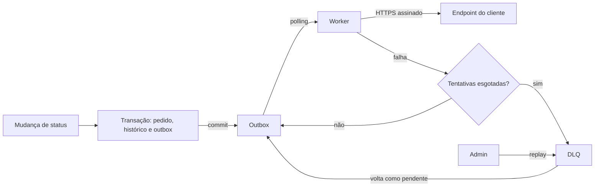

# RFC: Sistema de Webhooks de Notificação de Pedidos

## 1. Metadados

| Campo | Valor |
|---|---|
| **Autor** | Juliano |
| **Status** | Em revisão |
| **Data** | 2026-10-31 (data de elaboração; `TRANSCRICAO.md` registra a reunião apenas como "quinta-feira, 09:00") |
| **Revisores** | Larissa (Tech Lead), Marcos (Product Manager), Bruno (Engenheiro Pleno, time de Pedidos), Diego (Engenheiro Sênior, time de Plataforma), Sofia (Engenheira de Segurança) |

Larissa prevê revisar o design com Bruno e Diego antes de codar (`[09:50] Larissa`). Marcos e Sofia não participaram da decisão do snapshot ([ADR-007](./adrs/ADR-007-evento-materializado-na-insercao.md)).

## 2. Resumo executivo

Propomos notificar clientes B2B sobre mudanças de status de pedidos por webhooks de saída. O evento é gravado na `webhook_outbox`, na transação de `OrderService.changeStatus` que já atualiza `orders`, `order_status_history` e o estoque (`[09:40] Bruno`). Um worker em processo separado o entrega com assinatura HMAC, retry e DLQ, com garantia at-least-once. A proposta usa o MySQL existente, sem Redis (`[09:07] Diego`), e entra como módulo igual aos demais, com `AppError` e Pino (`[09:30] Larissa`). Os principais pontos em aberto são o controle de acesso atual e o efeito de um worker único na meta de 10 segundos.

## 3. Contexto e problema

Atlas Comercial, MaxDistribuição e Nova Cargo pediram formalmente para ser notificadas quando o status dos seus pedidos muda. Hoje elas consultam `GET /orders` periodicamente, o que deixa a integração "lenta e cara" (`[09:00] Marcos`). Para esses clientes, menos de 10 segundos já é "tempo real" (`[09:02] Marcos`). O fluxo é só de saída (`[09:02] Marcos`). A Atlas sugeriu que pode migrar para um concorrente se não houver entrega até o fim do trimestre (`[09:00] Marcos`), e depois o prazo foi citado como fim de novembro (`[09:45] Marcos`).

A busca em `src/`, `prisma/` e `tests/` não encontrou eventos, filas, webhooks nem cliente HTTP. A mudança de status ocorre em uma transação (`OrderService.changeStatus`, em `src/modules/orders/order.service.ts`), na qual uma chamada a um cliente lento travaria outras mudanças (`[09:04] Bruno`).

## 4. Proposta técnica

### 4.1 Componentes

| ID | Componente | Papel | Decisão |
|---|---|---|---|
| RFC-COMP-01 | Outbox | Registra o evento na transação da mudança de status, já filtrado e com o payload pronto | [ADR-001](./adrs/ADR-001-outbox-no-mysql.md), [ADR-007](./adrs/ADR-007-evento-materializado-na-insercao.md) |
| RFC-COMP-02 | Worker | Lê a outbox por polling, em processo próprio | [ADR-002](./adrs/ADR-002-worker-separado-em-polling.md) |
| RFC-COMP-03 | Entrega | Envia por HTTPS (`[09:23] Sofia`), reenvia em caso de falha e identifica cada evento para deduplicação | [ADR-003](./adrs/ADR-003-retry-com-backoff-e-dlq.md), [ADR-005](./adrs/ADR-005-entrega-at-least-once-com-event-id.md) |
| RFC-COMP-04 | Assinatura | Permite ao cliente validar origem e integridade, com secret por endpoint | [ADR-004](./adrs/ADR-004-assinatura-hmac-com-secret-por-endpoint.md) |
| RFC-COMP-05 | DLQ | Guarda os eventos que esgotaram as tentativas, para debug e replay manual | [ADR-003](./adrs/ADR-003-retry-com-backoff-e-dlq.md) |
| RFC-COMP-06 | API de gestão | Cadastro de webhooks e rotação de secret (`[09:21] Sofia`, `[09:31] Marcos`, `[09:33] Bruno`), histórico de entregas (`[09:34] Marcos`) e replay | [ADR-006](./adrs/ADR-006-reuso-dos-padroes-existentes.md), [ADR-008](./adrs/ADR-008-controle-de-acesso-da-api-de-webhooks.md) |

### 4.2 Fluxo em alto nível

### 4.3 Garantias oferecidas

| ID | Garantia | Limite | Decisão |
|---|---|---|---|
| RFC-GAR-01 | Status alterado e evento registrado são atômicos | Vale para `changeStatus`, ponto de integração citado em `[09:40] Bruno` | [ADR-001](./adrs/ADR-001-outbox-no-mysql.md) |
| RFC-GAR-02 | Entrega at-least-once | O cliente precisa deduplicar | [ADR-005](./adrs/ADR-005-entrega-at-least-once-com-event-id.md) |
| RFC-GAR-03 | Ordem por `order_id` | Sem ordem global e apenas com um único worker (`[09:13] Larissa`); ver INF-05 ao final | [ADR-002](./adrs/ADR-002-worker-separado-em-polling.md) |
| RFC-GAR-04 | Origem e integridade verificáveis | O cliente precisa validar a assinatura | [ADR-004](./adrs/ADR-004-assinatura-hmac-com-secret-por-endpoint.md) |

A notificação em menos de 10 segundos é uma meta (`[09:02] Marcos`), não uma garantia: não se aplica durante retry, e RFC-Q-07 trata do outro limite.

### 4.4 Fora desta proposta

| ID | Item | Fonte |
|---|---|---|
| RFC-FORA-01 | Webhooks de entrada | `[09:02] Marcos`, `[09:03] Sofia` |
| RFC-FORA-02 | Dashboard visual, que é projeto separado do time de frontend | `[09:39] Marcos`, `[09:40] Larissa` |

## 5. Alternativas consideradas

Todas foram descartadas na reunião; os detalhes estão nos ADRs indicados. RFC-ALT-13 não tem ADR por não ser decisão arquitetural separada (`[09:24] Larissa`).

| ID | Alternativa | Trade-off que motivou o descarte | Fonte | ADR |
|---|---|---|---|---|
| RFC-ALT-01 | HTTP síncrono na transação | Cliente lento travaria outras mudanças, e cliente fora do ar não pode causar rollback | `[09:04] Bruno`, `[09:06] Diego` | 001 |
| RFC-ALT-02 | Redis Streams ou Redis Cluster | Mais infraestrutura para um time pequeno: overengineering | `[09:07] Larissa`, `[09:07] Diego` | 001 |
| RFC-ALT-03 | Trigger no banco para acionar o worker | Mais reativo, mas trigger só executa SQL e avisar o worker exigiria improviso | `[09:09] Bruno`, `[09:09] Diego` | 002 |
| RFC-ALT-04 | Worker dentro do processo da API | Um reinício da API derrubaria o worker | `[09:11] Diego` | 002 |
| RFC-ALT-05 | Retry indefinido | Sem limite, o evento fica pendurado para sempre | `[09:15] Diego` | 003 |
| RFC-ALT-06 | 3 tentativas | Mais agressivo, mas não cobre uma manutenção de 2 horas | `[09:16] Bruno`, `[09:16] Diego` | 003 |
| RFC-ALT-07 | Marcar `failed` na própria outbox, sem tabela separada | Leitura menos limpa e perda da evidência separada | `[09:17] Larissa`, `[09:18] Diego` | 003 |
| RFC-ALT-08 | Secret global | "Se vaza uma, vaza tudo" | `[09:21] Sofia` | 004 |
| RFC-ALT-09 | Exactly-once | Tiraria a deduplicação do cliente, mas exige coordenação dos dois lados | `[09:25] Sofia`, `[09:25] Diego` | 005 |
| RFC-ALT-10 | Filtrar status na hora do envio | Geraria linhas desnecessárias na outbox | `[09:34] Diego`, `[09:34] Bruno` | 007 |
| RFC-ALT-11 | Renderizar o payload na hora do envio | O evento deixaria de refletir o momento da mudança | `[09:51] Bruno`, `[09:52] Larissa` | 007 |
| RFC-ALT-12 | `customer_id` implícito no JWT | O JWT é do usuário operador, não do cliente | `[09:31] Marcos`, `[09:32] Bruno`, `[09:32] Larissa` | 008 |
| RFC-ALT-13 | Truncar payload acima do limite | Tamanho excessivo indica erro, então é melhor falhar | `[09:23] Sofia`, `[09:24] Larissa` | — |

## 6. Questões em aberto

### Levantadas na reunião

| ID | Questão | Situação | Quem levantou | O que falta para decidir |
|---|---|---|---|---|
| RFC-Q-01 | Rate limiting de saída | Em observação (`[09:39] Larissa`) | Diego (`[09:38] Diego`) | Observar se vira problema (`[09:39] Diego`); a reunião não definiu como medir |
| RFC-Q-02 | Endurecer as permissões do CRUD | Adiado | Sofia (`[09:37] Sofia`), após `[09:36] Marcos` | Definir quando e como; ligado a RFC-RISCO-02 e RFC-RISCO-03 |
| RFC-Q-03 | Aviso por e-mail quando o webhook falha | Adiado para a próxima fase (`[09:37] Larissa`) | Marcos (`[09:37] Marcos`) | Medir o impacto antes (`[09:37] Larissa`) |
| RFC-Q-04 | Múltiplos workers | Adiado (`[09:13] Diego`) | Bruno (`[09:13] Bruno`) | Necessidade de escalar e escolha entre partição por `order_id` ou lock pessimista (`[09:13] Diego`) |
| RFC-Q-05 | Arquivamento das linhas entregues | Fora do escopo; janela imprecisa, "30 dias ou assim" | Diego (`[09:08] Diego`) | Definir a janela e quando será feito |
| RFC-Q-06 | Prazo com a Atlas | Marcos ficou de confirmar (`[09:47] Marcos`) | Marcos (`[09:45] Marcos`) | Confirmação do cliente; ver RFC-RISCO-06 |

### Identificadas na elaboração deste RFC, não discutidas na reunião

| ID | Questão | O que falta para decidir |
|---|---|---|
| RFC-Q-07 | Worker único e sequencial com timeout de 10s (`[09:42] Diego`) contra a meta de 10s (`[09:02] Marcos`) | Avaliar se o atraso entre clientes é aceitável |
| RFC-Q-08 | Destino da linha da DLQ depois do replay | Definir o comportamento antes da implementação |
| RFC-Q-09 | Eventos pendentes quando o webhook é editado ou removido | Definir o comportamento antes da implementação |
| RFC-Q-10 | Criptografia da secret em repouso (⚠️ INF-42) | Encaminhado à revisão da Sofia (⚠️ INF-38) |
| RFC-Q-11 | SSRF por URL cadastrada (⚠️ INF-42) | Encaminhado à revisão da Sofia (⚠️ INF-38) |
| RFC-Q-12 | `X-Timestamp` fora da assinatura ([ADR-004](./adrs/ADR-004-assinatura-hmac-com-secret-por-endpoint.md)) | Encaminhado à revisão da Sofia (⚠️ INF-38) |

## 7. Impacto e riscos

### Impacto no sistema atual

| ID | Área | Impacto | Fonte |
|---|---|---|---|
| RFC-IMP-01 | Pedidos | `OrderService.changeStatus` passa a gravar o evento na transação, e uma falha nessa gravação faz rollback | `src/modules/orders/order.service.ts`, `[09:40] Bruno` |
| RFC-IMP-02 | Dados | Novos modelos no schema e no mesmo banco | `prisma/schema.prisma`, `[09:07] Diego` |
| RFC-IMP-03 | Aplicação | Novo módulo ligado à composição e às rotas existentes | `src/app.ts`, `src/routes/index.ts`, `[09:27] Bruno` |
| RFC-IMP-04 | Testes e seed | Tabelas novas entram na limpeza; ver FDD-INT-09 e FDD-INT-10 | `tests/setup.ts`, `prisma/seed.ts` |

### Operação

| ID | Impacto | Fonte |
|---|---|---|
| RFC-OP-01 | Segundo processo para implantar e operar, com novo entry-point ao lado de `src/server.ts` | `[09:11] Larissa`, `src/server.ts` |
| RFC-OP-02 | Reprocessamento da DLQ é manual, feito por `ADMIN` | `[09:18] Diego`, `[09:36] Larissa` |
| RFC-OP-03 | Marcos documenta a integração e o at-least-once no portal de desenvolvedor | `[09:26] Marcos`, `[09:40] Marcos` |

### Segurança

Sofia pediu ao menos 2 dias úteis de revisão antes do deploy, com foco em HMAC e geração de secret (`[09:46] Sofia`, `[09:49] Sofia`). Este RFC encaminha RFC-RISCO-02 e RFC-RISCO-03 a essa revisão (⚠️ INF-38).

### Riscos

| ID | Risco | Fonte | Tratamento nesta proposta |
|---|---|---|---|
| RFC-RISCO-01 | Um cliente sem resposta atrasa os demais além da meta de 10s | `[09:02] Marcos`, `[09:12] Diego`, `[09:42] Diego` | Aberto em RFC-Q-07 |
| RFC-RISCO-02 | A exigência de `ADMIN` pode ser contornada: o registro é público e aceita essa role (leitura do código, não reproduzida) | `src/modules/auth/auth.routes.ts`, `src/modules/auth/auth.schemas.ts` | Encaminhado à revisão de segurança (⚠️ INF-38) |
| RFC-RISCO-03 | Sem isolamento entre clientes: `User` não tem vínculo com `Customer`, ao contrário do que sugere `[09:32] Marcos` | `prisma/schema.prisma` | Encaminhado à revisão de segurança (⚠️ INF-38) |
| RFC-RISCO-04 | Requisições simultâneas em `changeStatus`, que não tem lock, poderiam gerar eventos com IDs distintos, que a deduplicação não pega (leitura do código, não reproduzida) | `src/modules/orders/order.service.ts` | Registrado, sem mudança proposta |
| RFC-RISCO-05 | Outbox cresce sem arquivamento nesta entrega | `[09:07] Bruno`, `[09:08] Diego` | Aberto em RFC-Q-05 |
| RFC-RISCO-06 | A estimativa de 3 sprints (`[09:47] Larissa`) pode não caber no fim de novembro (`[09:45] Marcos`): a duração da sprint não foi citada | `[09:47] Larissa`, `[09:45] Marcos` | Aberto em RFC-Q-06 |

## 8. Decisões relacionadas

| ADR | Decisão em uma linha |
|---|---|
| [ADR-001](./adrs/ADR-001-outbox-no-mysql.md) | Outbox no MySQL, na mesma transação da mudança de status |
| [ADR-002](./adrs/ADR-002-worker-separado-em-polling.md) | Um único worker, em processo separado, com polling de 2 segundos |
| [ADR-003](./adrs/ADR-003-retry-com-backoff-e-dlq.md) | Retry com backoff exponencial e DLQ em tabela separada |
| [ADR-004](./adrs/ADR-004-assinatura-hmac-com-secret-por-endpoint.md) | HMAC-SHA256, secret por endpoint e rotação com 24 horas de carência |
| [ADR-005](./adrs/ADR-005-entrega-at-least-once-com-event-id.md) | At-least-once, com deduplicação no cliente por `X-Event-Id` |
| [ADR-006](./adrs/ADR-006-reuso-dos-padroes-existentes.md) | Webhooks como módulo comum, reusando os padrões do projeto |
| [ADR-007](./adrs/ADR-007-evento-materializado-na-insercao.md) | Filtro de status e snapshot do payload na inserção da outbox |
| [ADR-008](./adrs/ADR-008-controle-de-acesso-da-api-de-webhooks.md) | JWT existente, `customer_id` explícito e `ADMIN` apenas no replay |

## Inferências para revisão humana

> ⚠️ Inferência (sem fonte direta): **INF-05.** A ordem por `order_id` só vale sem retry: um evento em backoff pode ser ultrapassado pelo seguinte do mesmo pedido, e não há bloqueio por pedido. Apoio: `[09:12] Diego`, `[09:13] Larissa`.

> ⚠️ Inferência (sem fonte direta): **INF-38.** O encaminhamento à revisão da Sofia é decisão de quem escreve; o foco citado por ela é HMAC e geração de secret (`[09:46] Sofia`).

> ⚠️ Inferência (sem fonte direta): **INF-42.** Criptografia em repouso e SSRF foram levantados na elaboração, sem fonte.

As demais inferências que sustentam a proposta estão registradas nos ADRs correspondentes.
